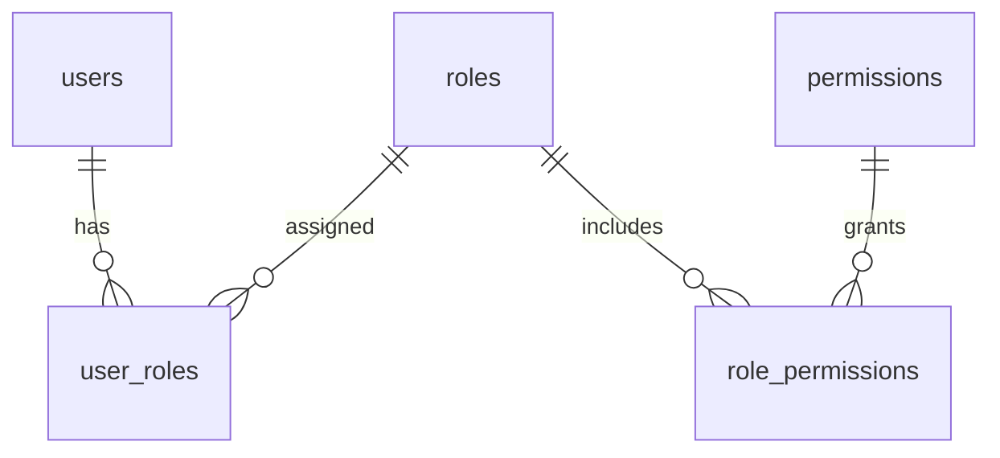

# База данных: ПАСЗИ, лабораторная 4, вариант 3

Компонент PostgreSQL для регистрации пользователей и ролевой модели доступа (RBAC).
Включает пять таблиц, ORM-модели SQLAlchemy, две миграции Alembic, начальные роли и права,
запрос получения прав пользователя и тесты на PostgreSQL.

## Структура

| Файл или каталог | Назначение |
| --- | --- |
| `database/models.py` | Модели пяти таблиц и связей |
| `database/config.py` | Чтение `DATABASE_URL` и создание SQLAlchemy Engine |
| `database/configure.py` | Проверка подключения и создание локального `.env` |
| `database/queries.py` | Получение объединения прав всех ролей пользователя |
| `database/inspect_db.py` | Просмотр структуры, количества записей и прав ролей |
| `database/sql/inspect.sql` | Запросы для psql или pgAdmin |
| `alembic.ini`, `migrations/` | Конфигурация, создание схемы и начальное заполнение |
| `requirements-db.txt` | Зафиксированные версии основных зависимостей |
| `tests/database/` | Интеграционные тесты БД |

Python 3.11 или новее.

## Локальный запуск в PowerShell

Рабочая папка: корень клонированного репозитория. PostgreSQL должен быть запущен.
База `pasis_db` и её владелец `pasis_user` создаются администратором PostgreSQL один раз.
У `pasis_user` нет полномочий SUPERUSER, CREATEDB и CREATEROLE; он владелец базы проекта.

```powershell
python -m venv .venv
.\.venv\Scripts\python.exe -m pip install -r requirements-db.txt
.\.venv\Scripts\python.exe -m database.configure
.\.venv\Scripts\python.exe -m alembic upgrade head
.\.venv\Scripts\python.exe -m alembic current
.\.venv\Scripts\python.exe -m database.inspect_db
```

Если `.venv` уже создана и пакеты установлены, начинайте с `database.configure`.
Скрипт запросит пароль `pasis_user` без отображения ввода, проверит подключение и создаст `.env`.
Существующий `.env` он не перезаписывает. Специальные символы пароля кодируются для URL автоматически.
Альтернативные параметры задаются флагами `--host`, `--port`, `--user`, `--database`.

В `.env.example` находятся только примеры. Настоящие пароли и `SECRET_KEY` в Git не отправляются.
Переменная окружения `DATABASE_URL` имеет приоритет над `.env`.
Для Linux/macOS используйте `./.venv/bin/python` вместо `.\.venv\Scripts\python.exe`.

### Если Windows блокирует Cython-модуль SQLAlchemy

Для обычных синхронных запросов можно установить SQLAlchemy без скомпилированных расширений:

```powershell
$env:DISABLE_SQLALCHEMY_CEXT = "1"
.\.venv\Scripts\python.exe -m pip install --force-reinstall --no-cache-dir --no-deps --no-binary=SQLAlchemy "SQLAlchemy==2.1.9"
Remove-Item Env:\DISABLE_SQLALCHEMY_CEXT
```


## Таблицы и ограничения

| Таблица | Основные поля | Ограничения |
| --- | --- | --- |
| `users` | `id`, `login`, `password_hash`, `created_at` | PK; уникальный login; допустимые символы и длина 3-32; обязательный непустой хэш |
| `roles` | `id`, `name`, `description` | PK; уникальное имя роли |
| `permissions` | `id`, `code`, `description` | PK; уникальный код права |
| `user_roles` | `user_id`, `role_id` | Составной PK; два внешних ключа |
| `role_permissions` | `role_id`, `permission_id` | Составной PK; два внешних ключа |

`id` генерируется PostgreSQL через IDENTITY. `created_at` имеет тип TIMESTAMP WITH TIME ZONE
и заполняется серверным `now()`. Логины чувствительны к регистру: `Student` и `student` различаются.
Уникальное ограничение автоматически создаёт уникальный индекс `uq_users_login`.

Пользователь может иметь несколько ролей. Права вычисляются как объединение прав этих ролей,
без повторов. Пользователь без ролей получает пустой набор прав. Прямых назначений прав
пользователю в этой модели нет.

Внешние ключи связующих таблиц используют ON DELETE CASCADE. Удаление пользователя удаляет
его назначения ролей, сохраняя сами роли. Удаление роли удаляет её назначения и связи с правами,
сохраняя пользователей и справочник прав.

Кроме пяти прикладных таблиц Alembic создаёт служебную таблицу `alembic_version`.



## Начальные роли и права

`0001_schema` создаёт таблицы. `0002_rbac_seed` добавляет 3 роли, 4 права и 7 связей.
Учётные записи пользователей эти миграции не создают. Повторный `upgrade head` не дублирует данные.

| Право | user | moderator | admin |
| --- | :---: | :---: | :---: |
| `profile.read` - свой профиль | Да | Да | Да |
| `users.read` - список пользователей | Нет | Да | Да |
| `users.manage` - управление пользователями | Нет | Нет | Да |
| `roles.manage` - назначение и отзыв ролей | Нет | Нет | Да |

У `admin` все четыре существующих права. При добавлении новых прав их связь с `admin`
нужно явно добавить миграцией; скрытого обхода проверок по имени роли нет.


## Безопасность: что сделано

- Уникальный индекс защищает от дублирования логинов, в том числе при параллельной регистрации.
- CHECK, NOT NULL, составные PK и внешние ключи защищают целостность данных.
- В схеме предусмотрено только поле `password_hash`, отдельного поля открытого пароля нет.
  БД проверяет его непустоту; получение и проверка корректного криптографического хэша - обязанность backend.
- SQLAlchemy использует параметры запросов; пользовательский ввод не вставляется в SQL-строки.
- `echo=False` и `hide_parameters=True` уменьшают риск попадания данных в диагностические логи SQLAlchemy.
- `.env` и виртуальное окружение исключены из Git. `.env.example` не содержит настоящих секретов.
- Настройки Argon2id и остальные обязательные по ТЗ переменные предусмотрены в `.env.example`.

Техническая учётная запись `pasis_user` является владельцем базы и используется для миграций.
Её полномочия отличаются от ролей приложения, хранящихся в таблице `roles`.

## Проверки

```powershell
.\.venv\Scripts\python.exe -m alembic current
.\.venv\Scripts\python.exe -m alembic check
.\.venv\Scripts\python.exe -m database.inspect_db
```

Тесты выполняются в отдельной базе с именем, оканчивающимся на `_test`, и применёнными миграциями.
Для неё задайте `TEST_DATABASE_URL` в текущем терминале. Для применения миграций к тестовой базе
временно задайте такое же значение в `DATABASE_URL`; после миграций удалите только эту временную
переменную окружения, чтобы снова использовать настройки основной базы из `.env`.

```powershell
.\.venv\Scripts\python.exe -m pip install -r requirements-db-dev.txt
# TEST_DATABASE_URL must already contain the connection to a separate test database.
$env:DATABASE_URL = $env:TEST_DATABASE_URL
.\.venv\Scripts\python.exe -m alembic upgrade head
Remove-Item Env:\DATABASE_URL
.\.venv\Scripts\python.exe -m pytest tests/database -q
```

Тестовые записи откатываются после каждого теста; значения последовательностей могут увеличиться.
Проверяются ограничения, права ролей, объединение нескольких ролей, отзыв роли, отсутствие прав,
каскадное удаление и корректная обработка специальных символов в пароле подключения.
